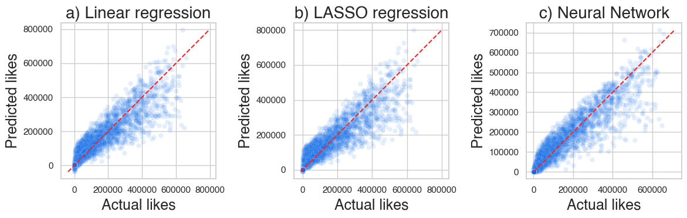

# Can Machine Learning Predict If Your TikTok Will Be a Hit or a Flop?

**Predicting the number of likes of a TikTok video from its metadata**

Nathan Tessot · CPES Data Science & Cultural Sciences, Université PSL

📄 **[Read the report (PDF)](report/TikTok_Likes_Prediction_Tessot.pdf)** · 📓 [Notebook](tiktok_likes_prediction.ipynb)

---

## Question

Can the number of likes of a TikTok video be predicted from its characteristics
(views, shares, comments, downloads, duration, transcription) and from the status
of its author (verified, banned)? Since the target is continuous, this is a
regression problem.

## Data and method

- **Data**: metadata of 19,382 TikTok videos, 19,084 after removing missing values,
  described in [`data/codebook.xlsx`](data/codebook.xlsx).
- **Feature engineering**: 25 new variables, including log transforms, engagement
  ratios (shares, comments and downloads per view), encoded categorical variables,
  text features from the transcription and duration-based rates.
- **Protocol**: standardized features, 75/25 train/test split, three models tuned
  with 5-fold cross-validation and compared on RMSE:
  - linear regression
  - LASSO regression (regularization strength tuned over seven values from 1 to 10⁶)
  - neural network (multilayer perceptron; architecture, activation, solver,
    learning rate and batch size tuned by grid search)

## Results

| Model | Train RMSE | Test RMSE |
|-------|-----------:|----------:|
| Linear regression | 49,435 | 49,926 |
| LASSO regression | 49,881 | 50,409 |
| **Neural network** (2 hidden layers, 8 and 4 units, ReLU) | **44,611** | **44,532** |



The neural network performs best, with a test error about 11% lower than the linear
models. Its test RMSE (about 44,500 likes) is roughly a third of the standard
deviation of likes in the data (about 133,000), and train and test errors are close,
so the model does not overfit.

## Repository structure

```
├── tiktok_likes_prediction.ipynb   Full analysis: cleaning, features, models, evaluation
├── data/
│   ├── tiktok_dataset.csv          Raw dataset
│   └── codebook.xlsx               Description of each variable
├── report/
│   ├── TikTok_Likes_Prediction_Tessot.pdf
│   └── figures/
└── requirements.txt
```

## How to run

```bash
pip install -r requirements.txt
jupyter notebook tiktok_likes_prediction.ipynb
```

The full neural-network grid search takes several minutes.
